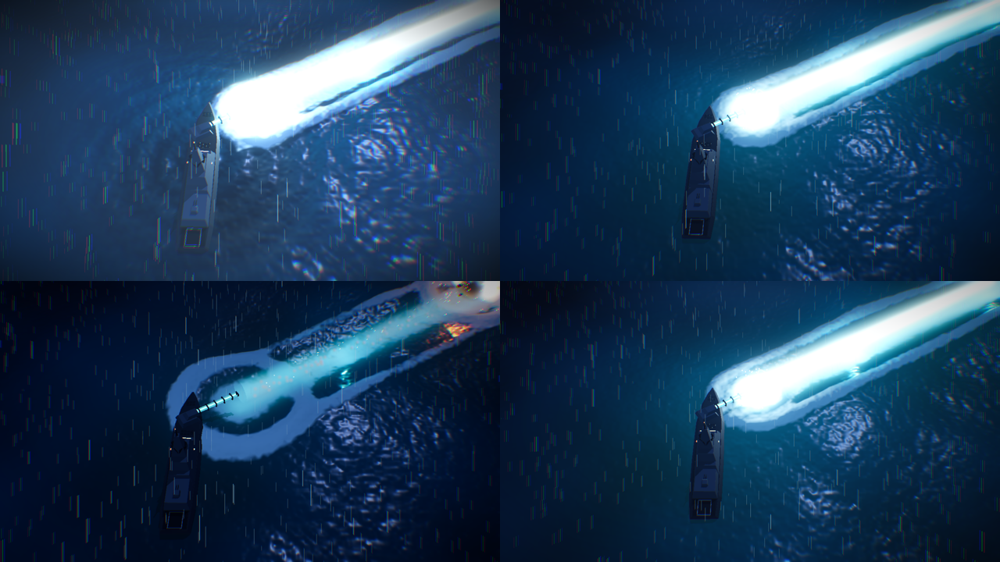

# Modern Ships

2.5D-Seegefecht in einer stürmischen Nacht: Du kommandierst einen modernen Stealth-Zerstörer mit einer Railgun. Gebaut mit Godot 4.7.2 für den Desktop.



**Stand: Etappe 1 – ein Gefecht.** Drei Wellen aus Schnellbooten, Stealth-Fregatten und Jagd-U-Booten.

## Spielen

Fertige Builds hängt jeder CI-Lauf als Artefakte an (Actions → letzter Lauf → *Artifacts*). Getaggte Versionen (`v*`) erscheinen unter *Releases*.

| System | Datei | Start |
|---|---|---|
| Windows on ARM (Snapdragon) | `modern-ships-windows-arm64` → `ModernShips.exe` | Doppelklick. Die exe ist nicht signiert, deshalb warnt SmartScreen: „Weitere Informationen“ → „Trotzdem ausführen“. |
| Linux x86_64 (z. B. Omarchy) | `modern-ships-linux-x86_64` → `ModernShips.x86_64` | `chmod +x ModernShips.x86_64 && ./ModernShips.x86_64` |

### Steuerung

| Eingabe | Wirkung |
|---|---|
| W / S | Fahrt voraus / bremsen und rückwärts. Das Schiff hat Trägheit. |
| A / D | Ruder. Wie stark es dreht, hängt von der Fahrt ab. |
| Maus | Railgun-Turm zielen (±150°, nach achtern verdecken die Aufbauten). |
| Linksklick halten | Laden (1,2 s), dann loslassen = Schuss. Der Schuss durchschlägt alles in einer Linie. |
| Länger halten | Überladung: bis doppelter Schaden und breiterer Strahl, aber die Hitze steigt. Bei Überhitzung gibt es eine Fehlzündung (eigener Schaden, 4 s gesperrt). |
| Esc | Pause |

Die Flak am Heck bekämpft Schnellboote automatisch.

### Grafik

Im Titelbildschirm kannst du zwischen **Hoch** (Forward+, volumetrischer Nebel) und **Mittel** (Mobile-Renderer, schneller) wechseln. Der Wechsel startet das Spiel neu. Windows nutzt Direct3D 12, Linux nutzt Vulkan.

## Entwicklung

```bash
tools/run_tests.sh                                   # GUT-Tests (headless)
tools/capture.sh railgun 1280x720                    # Screenshot-Szenario rendern (xvfb + Vulkan)
tools/capture.sh battle 1280x720 res://main/battle.tscn
blender -b --factory-startup --python tools/blender/build_models.py -- game/assets/models   # Modelle neu erzeugen
python3 tools/audio/synth.py game/assets/audio       # Sounds neu erzeugen
```

- Design: [`docs/superpowers/specs/2026-11-22-railgun-design.md`](docs/superpowers/specs/2026-11-22-railgun-design.md)
- Plan Etappe 1: [`docs/superpowers/plans/2026-11-22-etappe1-gefecht.md`](docs/superpowers/plans/2026-11-22-etappe1-gefecht.md)
- Alle Spielwerte stehen in `game/core/tuning.gd`.
- Assets: Modelle und Sounds werden per Skript erzeugt. Die Schriften (Chakra Petch, JetBrains Mono) stehen unter der SIL Open Font License, siehe `game/assets/fonts/`.
