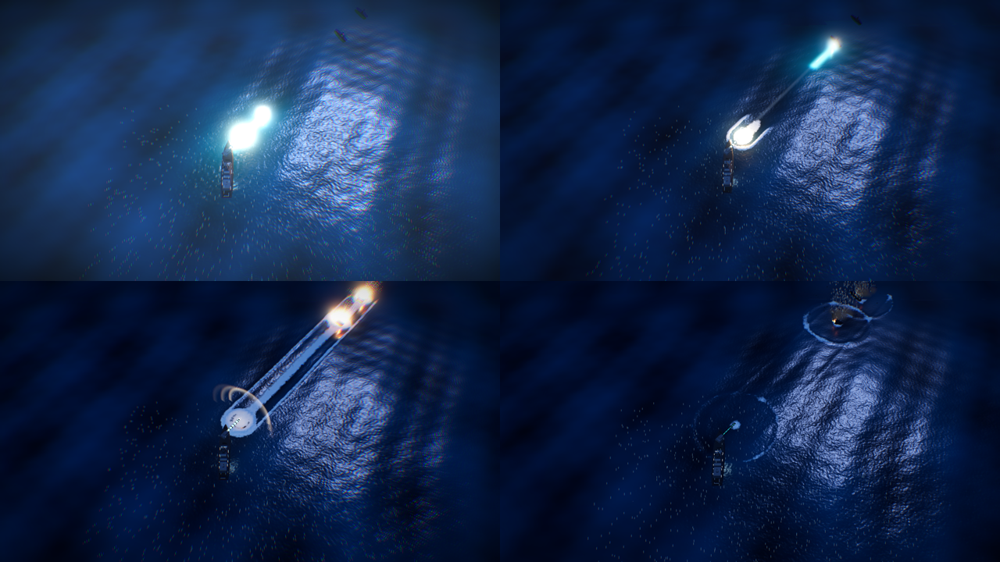

# Modern Ships

2.5D-Seegefecht in einer stürmischen Nacht: Du kommandierst einen modernen Stealth-Zerstörer mit einer Railgun. Gebaut mit Godot 4.7.2 für den Desktop.


**Stand: Etappe 1b – „schwer & mächtig“.** Ein Gefecht über drei Wellen auf einer 1,2-km-Karte: Fregatten, Zerstörer, ein Kreuzer, U-Boote und vereinzelt Schnellboote. Gesteuert wird wie in World of Warships mit Telegraf- und Ruderstufen, die Railgun verschießt ein Projektil mit Flugzeit.



## Spielen

Fertige Builds hängt jeder CI-Lauf als Artefakte an (Actions → letzter Lauf → *Artifacts*). Getaggte Versionen (`v*`) erscheinen unter *Releases*.

| System | Datei | Start |
|---|---|---|
| Windows on ARM (Snapdragon) | `modern-ships-windows-arm64` → `ModernShips.exe` | Doppelklick. Die exe ist nicht signiert, deshalb warnt SmartScreen: „Weitere Informationen“ → „Trotzdem ausführen“. |
| Linux x86_64 (z. B. Omarchy) | `modern-ships-linux-x86_64` → `ModernShips.x86_64` | `chmod +x ModernShips.x86_64 && ./ModernShips.x86_64` |

### Steuerung

| Eingabe | Wirkung |
|---|---|
| W / S | Maschinentelegraf eine Stufe hoch bzw. runter: Zurück voll · Stopp · ¼ · ½ · ¾ · Voll. Die Stufe bleibt stehen, das Schiff braucht Zeit, um Fahrt aufzunehmen. |
| A / D | Ruder eine Stufe nach Backbord bzw. Steuerbord: Hart · Halb · Mitte. Die Stufe bleibt stehen, das Ruder läuft langsam nach. |
| Maus | Railgun-Turm zielen (±150°). Die rote Raute am Gegner zeigt, wohin du vorhalten musst. |
| Linksklick | Feuer, sobald geladen (Nachladen ca. 7 s, Ring am Zielkreuz) |
| Linksklick halten | Überladung: bis doppelter Schaden, durchschlägt mehr Ziele. Die Hitze steigt, bei Überhitzung gibt es eine Fehlzündung. |
| Mausrad | Zoom (4 Stufen) |
| Esc | Pause |

Die Flak am Heck bekämpft Schnellboote automatisch. Feindliche Granaten zeigen ihren Einschlagort mit einem roten Ring an. Weich ihnen mit Telegraf und Ruder aus.

### Grafik

Im Titelbildschirm kannst du zwischen **Hoch** (Forward+, volumetrischer Nebel) und **Mittel** (Mobile-Renderer, schneller) wechseln. Der Wechsel startet das Spiel neu. Windows nutzt Direct3D 12, Linux nutzt Vulkan.

## Entwicklung

```bash
tools/run_tests.sh                                   # GUT-Tests (headless)
tools/capture.sh railgun 1280x720                    # Screenshot-Szenario rendern (xvfb + Vulkan)
tools/capture.sh battle 1280x720 res://main/battle.tscn
blender -b --factory-startup --python tools/blender/build_models.py -- game/assets/models   # Modelle neu erzeugen
python3 tools/audio/synth.py game/assets/audio       # Sounds neu erzeugen
```

- Design: [`docs/superpowers/specs/2026-11-22-railgun-design.md`](docs/superpowers/specs/2026-11-22-railgun-design.md)
- Plan Etappe 1: [`docs/superpowers/plans/2026-11-22-etappe1-gefecht.md`](docs/superpowers/plans/2026-11-22-etappe1-gefecht.md)
- Design und Plan Etappe 1b: [`docs/superpowers/specs/2026-11-23-etappe1b-schwer-design.md`](docs/superpowers/specs/2026-11-23-etappe1b-schwer-design.md), [`docs/superpowers/plans/2026-11-23-etappe1b-schwer.md`](docs/superpowers/plans/2026-11-23-etappe1b-schwer.md)
- Alle Spielwerte stehen in `game/core/tuning.gd`.
- Assets: Modelle und Sounds werden per Skript erzeugt. Die Schriften (Chakra Petch, JetBrains Mono) stehen unter der SIL Open Font License, siehe `game/assets/fonts/`.
